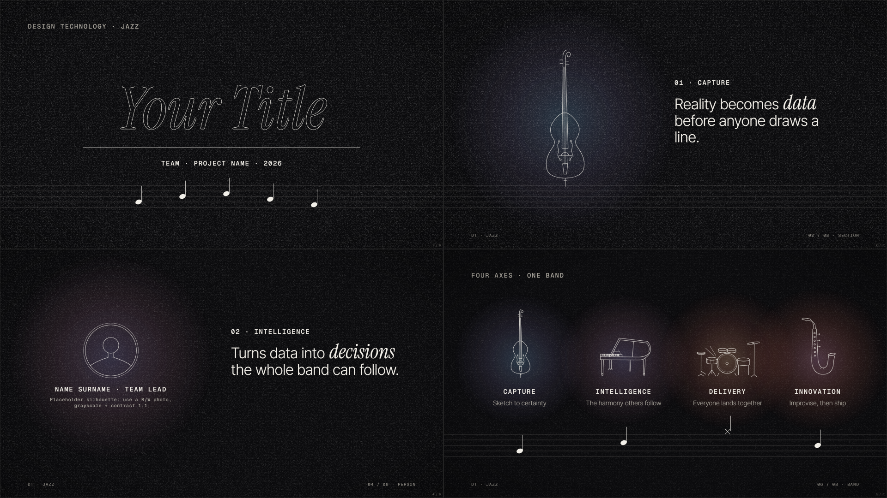

# Design Technology · Jazz — brand kit

**Español** · [English](#english)



## Español

### Qué es
Un estilo visual de «club de jazz oscuro» dibujado con una sola línea. Un equipo es una banda y cada eje de trabajo es un instrumento (contrabajo, piano, batería, saxofón); los conceptos se escriben como notación musical, no como diagramas.

- Fondo `#0B0B0D` con grano fino; línea blanco cálido `#F2EFE8` de 1–1.5 px.
- Un halo tenue por eje (máx. 30 % de opacidad) que respira, ligado a su instrumento.
- **Instrument Serif** itálica para el acento, **Inter Tight** 300 para frases, **Geist Mono** 500 en mayúsculas para etiquetas.
- Movimiento al pulso de 110 BPM, con acentos en los tiempos 2 y 4.

### Qué contiene
| Carpeta | Contenido |
|---|---|
| `tokens/` | `tokens.json` (colores, tipografía, espaciado, radios) y `tokens.css` |
| `assets/` | Instrumentos, notación, halos y grano en SVG |
| `fonts/` | WOFF2 para web, `ttf/` instalables para Office y licencias OFL |
| `templates/slides/index.html` | Deck HTML 1920×1080 con 8 layouts (flechas para navegar) |
| `powerpoint/` | `DT-Jazz.potx` (plantilla) y deck de ejemplo |
| `skills/dt-jazz/` y `skills/dt-jazz.zip` | Skill para Claude |
| `copilot/` | Instrucciones de agente, base de conocimiento y prompts para Microsoft 365 Copilot |
| `claude-design/project/` | Design System para Claude Design |
| `AGENTS.md`, `.github/copilot-instructions.md` | Reglas cortas para otros agentes |

### Cómo usarlo

**(a) Claude / Claude Design**
- Design System compartido en Claude: [Design Technology Jazz](https://claude.ai/artifact/RPZ9MxhyBuZcV9VBEkgCjM) (pide acceso al dueño; con acceso, elígelo al crear una presentación en Claude). También puedes importar la carpeta `claude-design/project` a tu propio Design System.
- Skill: en Claude sube `skills/dt-jazz.zip` en Settings → Capabilities → Skills. En Claude Code copia `skills/dt-jazz/` a `~/.claude/skills/`. Luego pide «hazme una presentación en el estilo DT Jazz».

**(b) Microsoft 365 Copilot (lo principal para el equipo)**
1. **Instala las fuentes.** PowerPoint en Windows no instala WOFF2: instala los TTF de `fonts/ttf/` (selecciónalos, doble clic, *Instalar*) y reinicia PowerPoint.
2. Abre la plantilla [`powerpoint/DT-Jazz.potx`](powerpoint/DT-Jazz.potx) en PowerPoint y pide a Copilot: «Create a presentation about …». Hereda el tema y los 8 layouts.
3. Crea un agente en Copilot (Agent Builder o Copilot Studio): pega [`copilot/agent-instructions.md`](copilot/agent-instructions.md) en las instrucciones y sube como conocimiento los archivos de `copilot/knowledge/*.md` y el `.potx`.
4. Prompts listos en [`copilot/prompts.md`](copilot/prompts.md).

> Nota honesta: Microsoft 365 Copilot puede usar modelos de Anthropic según la configuración de tu organización, pero **no ejecuta skills de Claude**. Por eso existen la plantilla `.potx` y las instrucciones de agente.

**(c) Otros agentes (ChatGPT, Gemini, Cursor, GitHub Copilot)**
Usa [`AGENTS.md`](AGENTS.md) o [`.github/copilot-instructions.md`](.github/copilot-instructions.md) (mismo contenido corto) y comparte `tokens/` y `assets/`.

### Web y HTML
```html
<link rel="stylesheet" href="tokens/tokens.css">
```
`tokens.css` declara las fuentes locales (`fonts/`), las variables (`--bg`, `--ink`, `--halo-capture-center`…) y clases de estilo tipográfico (`.phrase`, `.label`, `.accent`).

### Logo
El logo **no** está incluido. Coloca aquí el logo vigente desde la fuente oficial de marca (hueco documentado en el cierre de la plantilla).

### Licencias
Código, plantillas, SVG y documentación: MIT (`LICENSE`). Fuentes: SIL OFL 1.1 (`fonts/LICENSES.md`).

---

## English

### What it is
A dark jazz-club, line-art visual style drawn with a single thin line. A team is a band and each axis of work is an instrument (double bass, piano, drums, saxophone); concepts are written as musical notation, not diagrams.

- Background `#0B0B0D` with fine grain; warm-white line `#F2EFE8` at 1–1.5 px.
- One faint halo per axis (max 30% opacity) that breathes, tied to its instrument.
- **Instrument Serif** italic for the accent, **Inter Tight** 300 for phrases, **Geist Mono** 500 uppercase for labels.
- Motion on a 110 BPM pulse with accents on beats 2 and 4.

### What is inside
See the folder table above. `tokens/` (JSON + CSS), `assets/` (SVG), `fonts/` (WOFF2, installable TTF, OFL licenses), `templates/slides/` (HTML deck, 8 layouts), `powerpoint/` (`DT-Jazz.potx`), `skills/` (Claude skill), `copilot/` (agent instructions, knowledge, prompts), `claude-design/project/` (Design System), `AGENTS.md` and `.github/copilot-instructions.md`.

### How to use it

**(a) Claude / Claude Design**
- Shared Design System in Claude: [Design Technology Jazz](https://claude.ai/artifact/RPZ9MxhyBuZcV9VBEkgCjM) (ask the owner for access; then pick it when you create slides in Claude). Or import the `claude-design/project` folder into your own Design System.
- Skill: in Claude upload `skills/dt-jazz.zip` under Settings → Capabilities → Skills. In Claude Code copy `skills/dt-jazz/` to `~/.claude/skills/`. Then ask "make me a deck in the DT Jazz style".

**(b) Microsoft 365 Copilot (the main path for the team)**
1. **Install the fonts.** PowerPoint on Windows does not install WOFF2: install the TTF files in `fonts/ttf/` (select them, double-click, *Install*) and restart PowerPoint.
2. Open the template [`powerpoint/DT-Jazz.potx`](powerpoint/DT-Jazz.potx) in PowerPoint and ask Copilot "Create a presentation about …". It inherits the theme and the 8 layouts.
3. Create a Copilot agent (Agent Builder or Copilot Studio): paste [`copilot/agent-instructions.md`](copilot/agent-instructions.md) as instructions and upload `copilot/knowledge/*.md` and the `.potx` as knowledge.
4. Ready-made prompts: [`copilot/prompts.md`](copilot/prompts.md).

> Honest note: Microsoft 365 Copilot may use Anthropic models depending on your organization's configuration, but it **does not run Claude skills**. That is why the template and the agent instructions exist.

**(c) Other agents (ChatGPT, Gemini, Cursor, GitHub Copilot)**
Use [`AGENTS.md`](AGENTS.md) or [`.github/copilot-instructions.md`](.github/copilot-instructions.md) (same short content) and share `tokens/` and `assets/`.

### Web and HTML
```html
<link rel="stylesheet" href="tokens/tokens.css">
```

### Logo
The logo is **not** included. Place the current logo from the official brand source here (documented gap on the closing slide).

### Licenses
Code, templates, SVGs and docs: MIT (`LICENSE`). Fonts: SIL OFL 1.1 (`fonts/LICENSES.md`).
