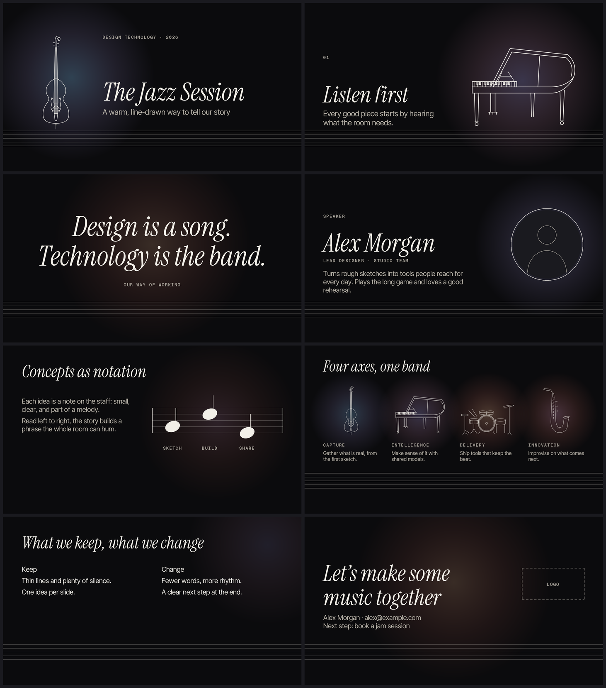

# Plantilla de PowerPoint · Design Technology · Jazz

**ES / EN**



## Contenido / Contents

| Archivo / File | Qué es / What it is |
|---|---|
| `DT-Jazz.potx` | Plantilla 16:9: tema (colores, fuentes) y 8 layouts. / 16:9 template: theme (colors, fonts) and 8 layouts. |
| `DT-Jazz-ejemplo.pptx` | Deck de ejemplo, una diapositiva por layout. / Example deck, one slide per layout. |
| `preview.png` | Mosaico de las 8 diapositivas. / Mosaic of the 8 slides. |
| `assets/instrumentos/` | Contrabajo, piano, batería y saxofón en SVG y PNG de línea blanca. / Line-art instruments (SVG + PNG). |
| `source/` | Scripts que generan todo (`build_template.py`, `instrumentos.py`, `preview.py`). / Scripts that generate everything. |

## Layouts

1. **Portada · Cover**: contrabajo con halo, título, subtítulo, etiqueta superior.
2. **Sección · Section**: número, título, frase corta; piano con halo.
3. **Frase grande · Big quote**: una frase en serif itálica y su autoría.
4. **Persona · Person**: imagen circular, nombre, rol, bio corta.
5. **Concepto en notación · Concept in notation**: texto + pentagrama con tres notas y tres etiquetas.
6. **Cuatro ejes · Four axes**: la banda (contrabajo, piano, batería, saxofón), cada uno con nombre y texto.
7. **Contenido de dos columnas · Two columns**.
8. **Cierre · Closing**: frase, contacto y marcador de **Logo**.

Los marcadores tienen nombres como «Título / Title», «Rol / Role», «Imagen circular / Round picture», «Eje 1 nombre / Axis 1 name», para que Copilot los identifique. No hay logos de Gensler ni fotos de personas: el cierre trae un marcador «Logo» (inserta el logo oficial) y Persona una imagen circular genérica que debes reemplazar.

## Estilo / Style

- Fondo `#0B0B0D`, texto `#F2EFE8`, secundario `#B9B4AA` (contraste 9.5:1 sobre el fondo).
- Acentos (solo halos tenues, nunca fondo): cielo `#7FB8E6`, lila `#A99BE0`, rosa `#E59BC0`, durazno `#F2B48C`, coral `#EE7F6E` = accent1 a accent5 (accent6 = blanco cálido).
- Líneas finas de 1 a 1,5 pt; pentagrama de 5 líneas al 35 % de opacidad abajo.
- Fuentes del tema: títulos **Instrument Serif** (itálica), cuerpo **Inter Tight**, etiquetas **Geist Mono** en mayúsculas con espaciado amplio.

## Fuentes / Fonts (importante)

Instala las fuentes de la carpeta `fonts/` de este repo (Google Fonts, licencia OFL) **antes** de abrir la plantilla: Instrument Serif, Inter Tight (o Inter como respaldo) y Geist Mono. Si no están instaladas, PowerPoint las sustituye por otra fuente y los textos pueden cambiar de ancho o verse distintos. Para presentar en otro equipo, instala también las fuentes allí (PowerPoint no las incrusta por defecto).

Install the fonts in the repo's `fonts/` folder (Google Fonts, OFL) before opening the template. Without them PowerPoint substitutes fonts and text may reflow. Install them on any machine used to present.

## Uso con Copilot / Using with Copilot

1. Abre `DT-Jazz.potx` (PowerPoint → Archivo → Nuevo → doble clic en el .potx; crea un deck nuevo con los layouts). Guarda el deck en OneDrive o SharePoint, que Copilot lo requiere.
2. Abre Copilot y escribe, por ejemplo:
   - «Create a presentation about our 2026 plans using this template.»
   - «Add a slide using the Persona layout for Alex Morgan, Lead Designer.»
   - «Add a slide using the Concepto en notación layout that explains our review process in three steps.»
   - «Use the Frase grande layout for this quote.»
   - «Finish with the Cierre layout.»
3. Revisa cada diapositiva: Copilot puede elegir otro layout, dejar marcadores vacíos o rellenar de más. Pídele «use the layout named …» si hace falta.

1. Open `DT-Jazz.potx` (File → New → double-click the .potx) and save the new deck to OneDrive or SharePoint, which Copilot requires.
2. Ask Copilot, e.g. "Create a presentation about … using this template", "Add a slide using the Persona layout".
3. Review every slide: Copilot may pick a different layout or leave placeholders empty.

## Límites conocidos / Known limits

- **Verificación:** la plantilla se generó y validó estructuralmente (esquema OOXML y apertura con python-pptx), pero **no se abrió en PowerPoint ni se renderizó con LibreOffice** (no disponible al crearla). `preview.png` es un render aproximado con Pillow a partir del mismo modelo de diseño; los halos y la tipografía pueden verse algo distintos en PowerPoint. Abre el .potx una vez y revisa antes de distribuirlo.
- Los halos son degradados radiales con transparencia: se ven bien en PowerPoint 2016+ y Microsoft 365; en visores antiguos o Keynote pueden aparecer planos.
- Copilot respeta mejor los layouts con pocos marcadores; en «Cuatro ejes» (9 marcadores) puede dejar alguno vacío. Los marcadores vacíos no se muestran al presentar, pero bórralos.
- Copilot no elige el instrumento: son parte del layout. Para cambiarlos, reemplaza la imagen en la vista Patrón de diapositivas con los archivos de `assets/instrumentos/`.
- Las etiquetas de nota del layout «Concepto en notación» están alineadas a tres notas fijas; si el texto de una etiqueta es largo, acórtalo.
- Sin foto de la persona ni logo: es un repo público.
- El tema define Instrument Serif como fuente de títulos; la cursiva está aplicada en el estilo de título, no en la fuente.
- El fondo es plano; no incluye la textura de grano del video.

## Regenerar / Rebuild

```
python source/instrumentos.py <ruta>/instrumentos.data.ts assets/instrumentos
python source/build_template.py .
```
